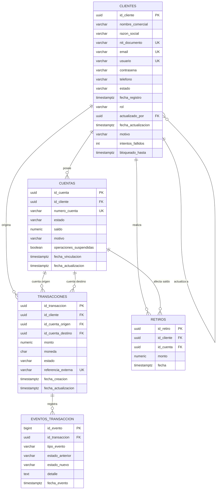

# BD-EAV08-2026-2
Repositorio para entregables propios de la materia de Bases de datos y laboratorios del equipo avanzado 8 de la edición 26-2 de CodeF@ctory, equipo conformado por:

YEPES JARAMILLO ANGEL SIMON: angel.yepes2@udea.edu.co
FORERO AGUDELO CARLOS ALBERTO: carlos.forero@udea.edu.co
ALBORNOZ VILLADIEGO JOSÉ FERNANDO: jose.albornoz@udea.edu.co
CONTRERAS PUELLO SAMUEL ESTEBAN: samuel.contreras@udea.edu.co

# CAMBIOS RESPECTO AL SPRINT 2

Para el **Sprint 3** (Motor Transaccional), el modelo de datos, el script físico, las consultas y el esquema de seguridad tuvieron muchos cambios respecto al Sprint 2, explicados asi:

1. **Nueva tabla `retiros`:** incorporamos la entidad `retiros` (`id_retiro`, `id_cliente`, `id_cuenta`, `monto`, `fecha`) para guardar el comprobante específico de cada retiro hecho por un cliente sobre una cuenta propia (`RetiroService`), manteniendo además el registro propio del movimiento en `transacciones` (`id_cuenta_origen`) y su trazabilidad en `eventos_transaccion` (`tipo_evento = 'retiro'`).
2. **Ajustes del MER respecto al entregado/usado en el Sprint 2:** Se eliminó del MER y de la matriz de seguridad las tablas `credenciales_api` y `reportes`, ya que quedaron fuera del alcance del core bancario implementado (`BackendBank`), dejando el modelo 100% consistente con las 5 tablas físicas en producción (`clientes`, `cuentas`, `transacciones`, `eventos_transaccion`, `retiros`) esto porque quedaba fuera del alcance propuesto para el sprint 3 ya que nos enfocamos en terminar el motor transaccional.
3. **Nuevas restricciones de integridad e índices en `transacciones` y `retiros`:**
   - Restricción `CHECK (id_cuenta_origen IS DISTINCT FROM id_cuenta_destino)` en `transacciones` para impedir transferencias hacia la misma cuenta a nivel de motor.
   - Restricción `CHECK (monto > 0)` en `transacciones` y `retiros` para garantizar montos estrictamente positivos en depósitos, retiros y transferencias.
   - Nuevos índices (`idx_cuentas_cliente_estado`, `idx_transacciones_cliente`, `idx_transacciones_estado`, `idx_transacciones_fecha`, `idx_transacciones_origen`, `idx_transacciones_destino`, `idx_retiros_cuenta`, `idx_retiros_cliente`, `idx_eventos_transaccion_id`) para optimizar consultas de estado de cuenta, historial de movimientos y validaciones de saldo.
4. **Automatización y reglas de negocio en base de datos (Triggers y Procedimientos):**
   - Se agregan **5 triggers** para validar titularidad de cuenta en retiros y transferencias, impedir transferencias a la misma cuenta, validar montos mayores a cero, auditar automáticamente cambios de estado en `transacciones` y actualizar `fecha_actualizacion`.
   - Se agregan **3 procedimientos almacenados** (`sp_depositar_dinero`, `sp_retirar_dinero`, `sp_transferir_dinero`) que encapsulan de forma atómica y transaccional las operaciones monetarias del Sprint 3.
5. **Actualización de consultas y seguridad:** Se ajustan las consultas de los Sprints 1 y 2 al esquema refinado, se añaden consultas para las HU del Sprint 3 y se actualiza la matriz de permisos (`GRANT`/`REVOKE` y políticas RLS) incluyendo `retiros` y los permisos `EXECUTE` sobre los procedimientos almacenados.

---

# Criterio 1 - MER Refinado

### Entidades y Relaciones

| Entidad | Descripción |
|---|---|
| `clientes` | Clientes/usuarios registrados en la plataforma bancaria, con credenciales, estado operativo, rol y auditoría de cambios |
| `cuentas` | Cuentas financieras vinculadas a cada cliente, con número de cuenta único, saldo disponible y estado operativo |
| `transacciones` | Movimientos financieros procesados (depósitos, retiros y transferencias entre cuentas del banco) |
| `eventos_transaccion` | Bitácora inmutable de auditoría que registra cada evento o cambio de estado de una transacción |
| `retiros` | Registro detallado de los retiros realizados por un cliente desde una de sus cuentas propias |

### Relaciones y cardinalidad

- Un `cliente` puede poseer cero o muchas `cuentas` (máximo 3 activas por regla de negocio); una `cuenta` pertenece a uno y solo un `cliente`.
- Un `cliente` puede ser actualizado por otro `cliente` con rol `ADMINISTRADOR` (`actualizado_por`); un administrador puede actualizar cero o muchos clientes.
- Un `cliente` puede originar cero o muchas `transacciones`; una `transacción` es originada por uno y solo un `cliente`.
- Una `cuenta` puede actuar como cuenta origen de cero o muchas `transacciones` y como cuenta destino de cero o muchas `transacciones`.
- Una `transacción` genera uno o muchos `eventos_transaccion`; cada evento pertenece a una y solo una `transacción`.
- Un `cliente` puede realizar cero o muchos `retiros` sobre sus `cuentas` propias; cada `retiro` pertenece a un `cliente` y a una `cuenta`.

### Diagrama E-R (Mermaid)



# Criterio 2 - Modelo físico completo (claves y restricciones)

Todas las tablas cumplen **3FN / BCNF**: cada atributo no clave depende de forma completa y no transitiva de su clave primaria, eliminando anomalías de inserción, actualización y borrado.

Ver script ejecutable completo en [`schema.sql`](./schema.sql).

### Tipos de datos y restricciones por tabla

#### `clientes`

| Columna | Tipo de dato | Restricciones |
|---|---|---|
| `id_cliente` | UUID | **PK**, `DEFAULT gen_random_uuid()` |
| `nombre_comercial` | VARCHAR(150) | NOT NULL |
| `razon_social` | VARCHAR(200) | NOT NULL |
| `nit_documento` | VARCHAR(30) | NOT NULL, UNIQUE |
| `email` | VARCHAR(150) | NOT NULL, UNIQUE |
| `usuario` | VARCHAR(80) | NOT NULL, UNIQUE |
| `contrasena` | VARCHAR(255) | NOT NULL (hash BCrypt) |
| `telefono` | VARCHAR(20) | — |
| `estado` | VARCHAR(30) | NOT NULL, `DEFAULT 'activo'`, CHECK IN (`pendiente_de_validacion`, `activo`, `inactivo`, `bloqueado`) |
| `fecha_registro` | TIMESTAMPTZ | NOT NULL, `DEFAULT now()` |
| `rol` | VARCHAR(20) | NOT NULL, `DEFAULT 'CLIENTE'`, CHECK IN (`CLIENTE`, `ADMINISTRADOR`) |
| `actualizado_por` | UUID | **FK** → `clientes(id_cliente)` |
| `fecha_actualizacion` | TIMESTAMPTZ | — |
| `motivo` | VARCHAR(200) | — |
| `intentos_fallidos` | INTEGER | NOT NULL, `DEFAULT 0` |
| `bloqueado_hasta` | TIMESTAMPTZ | — |

#### `cuentas`

| Columna | Tipo de dato | Restricciones |
|---|---|---|
| `id_cuenta` | UUID | **PK**, `DEFAULT gen_random_uuid()` |
| `id_cliente` | UUID | NOT NULL, **FK** → `clientes(id_cliente)` |
| `numero_cuenta` | VARCHAR(20) | NOT NULL, UNIQUE |
| `estado` | VARCHAR(30) | NOT NULL, `DEFAULT 'activo'`, CHECK IN (`activo`, `inactivo`, `bloqueado`) |
| `saldo` | NUMERIC(19,2) | NOT NULL, `DEFAULT 0`, CHECK (`saldo >= 0`) |
| `motivo` | VARCHAR(200) | — |
| `operaciones_suspendidas` | BOOLEAN | NOT NULL, `DEFAULT FALSE` |
| `fecha_vinculacion` | TIMESTAMPTZ | NOT NULL, `DEFAULT now()` |
| `fecha_actualizacion` | TIMESTAMPTZ | — |

#### `transacciones`

| Columna | Tipo de dato | Restricciones |
|---|---|---|
| `id_transaccion` | UUID | **PK**, `DEFAULT gen_random_uuid()` |
| `id_cliente` | UUID | NOT NULL, **FK** → `clientes(id_cliente)` ON DELETE RESTRICT |
| `id_cuenta_origen` | UUID | **FK** → `cuentas(id_cuenta)` ON DELETE RESTRICT (NULL en depósitos) |
| `id_cuenta_destino` | UUID | **FK** → `cuentas(id_cuenta)` ON DELETE RESTRICT (NULL en retiros) |
| `monto` | NUMERIC(14,2) | NOT NULL, CHECK (`monto > 0`) |
| `moneda` | CHAR(3) | NOT NULL, `DEFAULT 'COP'` |
| `estado` | VARCHAR(20) | NOT NULL, `DEFAULT 'creado'`, CHECK IN (`creado`, `aprobado`, `rechazado`, `reembolsado`) |
| `referencia_externa` | VARCHAR(100) | UNIQUE |
| `fecha_creacion` | TIMESTAMPTZ | NOT NULL, `DEFAULT now()` |
| `fecha_actualizacion` | TIMESTAMPTZ | NOT NULL, `DEFAULT now()` |

Restricción a nivel de tabla: `CHECK (id_cuenta_origen IS DISTINCT FROM id_cuenta_destino)`.

#### `eventos_transaccion`

| Columna | Tipo de dato | Restricciones |
|---|---|---|
| `id_evento` | BIGINT | **PK**, `GENERATED ALWAYS AS IDENTITY` |
| `id_transaccion` | UUID | NOT NULL, **FK** → `transacciones(id_transaccion)` ON DELETE CASCADE |
| `tipo_evento` | VARCHAR(50) | NOT NULL (`deposito`, `retiro`, `transferencia`, `cambio_estado`) |
| `estado_anterior` | VARCHAR(20) | — |
| `estado_nuevo` | VARCHAR(20) | — |
| `detalle` | TEXT | — |
| `fecha_evento` | TIMESTAMPTZ | NOT NULL, `DEFAULT now()` |

#### `retiros`

| Columna | Tipo de dato | Restricciones |
|---|---|---|
| `id_retiro` | UUID | **PK**, `DEFAULT gen_random_uuid()` |
| `id_cliente` | UUID | NOT NULL, **FK** → `clientes(id_cliente)` |
| `id_cuenta` | UUID | NOT NULL, **FK** → `cuentas(id_cuenta)` |
| `monto` | NUMERIC(14,2) | NOT NULL, CHECK (`monto > 0`) |
| `fecha` | TIMESTAMPTZ | NOT NULL, `DEFAULT now()` |

---

# Criterio 3 - Triggers coherentes con las HU

Los siguientes triggers están implementados en [`schema.sql`](./schema.sql) para blindar las reglas de negocio directamente en PostgreSQL/Supabase:

| Trigger | Tabla | Momento y Evento | HU que atiende | Propósito |
|---|---|---|---|---|
| `trg_validar_retiro` | `retiros` | `BEFORE INSERT` | *Retirar dinero solo desde una cuenta propia*; *Retirar dinero de una cuenta propia*; *Aceptar solo un monto de retiro mayor que cero* | Verifica que `monto > 0`, que la cuenta exista, que pertenezca al cliente (`id_cliente`), y que la cuenta esté en estado `'activo'` con `operaciones_suspendidas = FALSE`. |
| `trg_validar_transaccion` | `transacciones` | `BEFORE INSERT` | *Depositar dinero en una cuenta del banco*; *Enviar dinero solo desde una cuenta propia*; *Impedir la transferencia a la misma cuenta*; *Aceptar solo un monto mayor que cero*; *Transferir dinero a otra cuenta del mismo banco* | Valida que `monto > 0`, que exista al menos una cuenta involucrada, que origen y destino sean distintos, que la cuenta origen (si aplica) pertenezca al cliente y esté activa, y que la cuenta destino (si aplica) exista en el banco y esté activa. |
| `trg_auditar_cambio_estado_transaccion` | `transacciones` | `AFTER UPDATE OF estado` | *Consultar estado de cuenta (financiera)* (Sprint 2) y trazabilidad de *Transferir / Depositar / Retirar* (Sprint 3) | Registra automáticamente un evento en `eventos_transaccion` cada vez que cambia el estado de una transacción (`estado_anterior` → `estado_nuevo`). |
| `trg_actualizar_timestamp_cuentas` | `cuentas` | `BEFORE UPDATE` | *Bloquear cuenta (financiera)* (Sprint 2); *Depositar / Retirar / Transferir dinero* (Sprint 3) | Actualiza automáticamente `fecha_actualizacion = now()` cada vez que se modifica el saldo o el estado de una cuenta. |
| `trg_actualizar_timestamp_clientes` | `clientes` | `BEFORE UPDATE` | *Actualizar datos del perfil de un cliente*; *Cambiar el estado de un cliente (activo/inactivo)* (Sprint 1) | Actualiza automáticamente `fecha_actualizacion = now()` ante cualquier modificación en el perfil o estado del cliente. |

---
# Criterio 4 - Procedimientos coherentes con las HU

Los siguientes procedimientos almacenados en [`schema.sql`](./schema.sql) encapsulan de forma atómica las operaciones monetarias del **Sprint 3**:

### 1. `sp_depositar_dinero`
- **HU que atiende:** *Depositar dinero en una cuenta del banco*, *Aceptar solo un monto de depósito mayor que cero*.
- **Parámetros:**
  - `p_id_cliente UUID` (cliente autenticado que realiza el depósito)
  - `p_numero_cuenta VARCHAR(20)` (número de cuenta destino en el banco)
  - `p_monto NUMERIC(14,2)` (monto a depositar, debe ser `> 0`)
- **Comportamiento:** Valida que el monto sea positivo y que la cuenta destino exista y esté `'activo'` sin operaciones suspendidas; incrementa `cuentas.saldo`, registra la transacción aprobada en `transacciones` (`id_cuenta_destino`) y crea la constancia en `eventos_transaccion` (`tipo_evento = 'deposito'`).
- **Ejemplo de llamada:**
  ```sql
  CALL sp_depositar_dinero(
      '11111111-1111-1111-1111-111111111111',
      '1000000001',
      250000.00
  );
  ```

### 2. `sp_retirar_dinero`
- **HU que atiende:** *Retirar dinero solo desde una cuenta propia*, *Retirar dinero de una cuenta propia*, *Aceptar solo un monto de retiro mayor que cero*.
- **Parámetros:**
  - `p_id_cliente UUID` (cliente autenticado propietario de la cuenta)
  - `p_numero_cuenta VARCHAR(20)` (número de cuenta propia desde donde se retira)
  - `p_monto NUMERIC(14,2)` (monto a retirar, debe ser `> 0` y `<= saldo`)
- **Comportamiento:** Bloquea la fila de la cuenta (`FOR UPDATE`), verifica que el cliente esté `'activo'`, que la cuenta pertenezca a `p_id_cliente`, que esté `'activo'` sin operaciones suspendidas y que tenga saldo suficiente; descuenta `cuentas.saldo`, inserta el registro en `retiros`, registra la transacción aprobada en `transacciones` (`id_cuenta_origen`) y genera el evento en `eventos_transaccion` (`tipo_evento = 'retiro'`).
- **Ejemplo de llamada:**
  ```sql
  CALL sp_retirar_dinero(
      '11111111-1111-1111-1111-111111111111',
      '1000000001',
      80000.00
  );
  ```

### 3. `sp_transferir_dinero`
- **HU que atiende:** *Enviar dinero solo desde una cuenta propia*, *Impedir la transferencia a la misma cuenta*, *Aceptar solo un monto mayor que cero*, *Transferir dinero a otra cuenta del mismo banco*.
- **Parámetros:**
  - `p_id_cliente UUID` (cliente autenticado propietario de la cuenta origen)
  - `p_numero_cuenta_origen VARCHAR(20)` (cuenta propia debitada)
  - `p_numero_cuenta_destino VARCHAR(20)` (cuenta destino del mismo banco)
  - `p_monto NUMERIC(14,2)` (monto a transferir, debe ser `> 0`)
  - `p_referencia_externa VARCHAR(100) DEFAULT NULL` (referencia opcional única)
- **Comportamiento:** Valida que `p_monto > 0` y que `p_numero_cuenta_origen <> p_numero_cuenta_destino`; bloquea ambas cuentas en orden determinístico por `id_cuenta` para evitar interbloqueos (*deadlocks*); verifica que el cliente esté `'activo'`, que la cuenta origen pertenezca a `p_id_cliente`, que ambas cuentas estén `'activo'` sin operaciones suspendidas y que la cuenta origen tenga saldo suficiente; debita la cuenta origen, acredita la cuenta destino, registra la transacción aprobada en `transacciones` y guarda la auditoría en `eventos_transaccion` (`tipo_evento = 'transferencia'`).
- **Ejemplo de llamada:**
  ```sql
  CALL sp_transferir_dinero(
      '11111111-1111-1111-1111-111111111111',
      '1000000001',
      '1000000002',
      120000.00,
      'TRF-2026-0001'
  );
  ```
---


3 Versión


