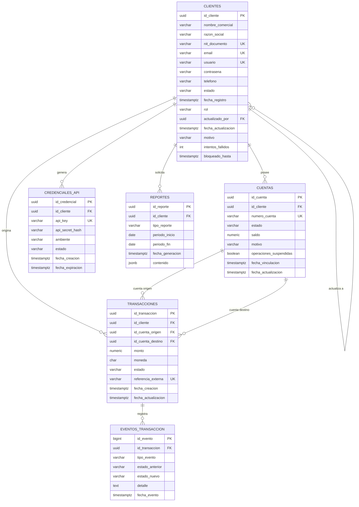
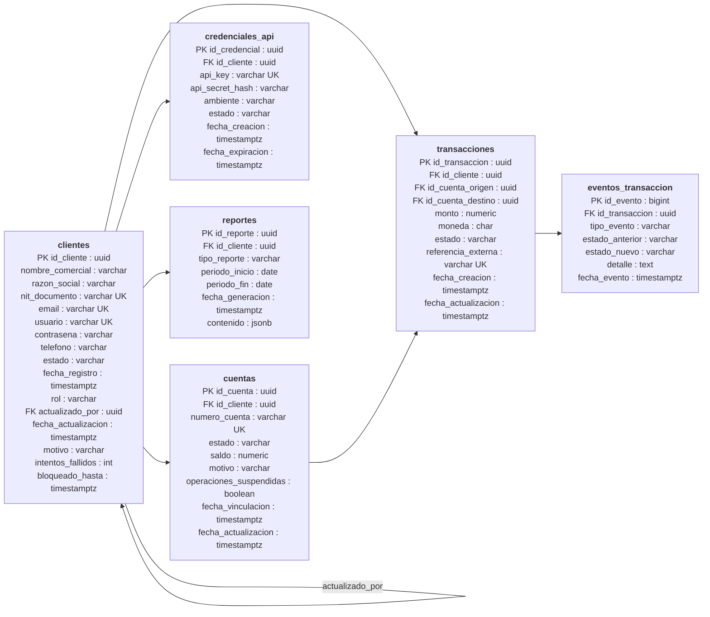

# BD-EAV08-2026-2
Repositorio para entregables propios de la materia de Bases de datos y laboratorios del equipo avanzado 8 de la edición 26-2 de CodeF@ctory, equipo conformado por:

YEPES JARAMILLO ANGEL SIMON: angel.yepes2@udea.edu.co
FORERO AGUDELO CARLOS ALBERTO: carlos.forero@udea.edu.co
ALBORNOZ VILLADIEGO JOSÉ FERNANDO: jose.albornoz@udea.edu.co
CONTRERAS PUELLO SAMUEL ESTEBAN: samuel.contreras@udea.edu.co

# CAMBIOS RESPECTO AL SPRINT 1

El MER del Sprint 1 se ajustó de acuerdo a decisiones tomadas durante la implementación:

- **`cuentas_bancarias` se renombra a `cuentas`** y se simplifica: se eliminan `banco`,
  `tipo_cuenta` y `moneda` (el backend no maneja múltiples bancos ni monedas todavía); se
  agregan `saldo`, `motivo`, `operaciones_suspendidas` y `fecha_actualizacion`, porque la
  cuenta ahora es el objeto que registra el dinero disponible y su estado operativo.
- **`clientes` gana autenticación y auditoría**: `usuario` y `contrasena` (hash BCrypt, ver
  `SeguridadConfig`), `rol` (`CLIENTE` / `ADMINISTRADOR`), `actualizado_por` (clave foránea
  recursiva hacia la misma tabla: qué usuario hizo el último cambio), `fecha_actualizacion`,
  `motivo`, `intentos_fallidos` y `bloqueado_hasta` (bloqueo temporal tras varios intentos
  fallidos de inicio de sesión).
- `transacciones.id_cuenta_origen` / `id_cuenta_destino` ahora referencian `cuentas` en vez de
  `cuentas_bancarias`.
- `credenciales_api`, `eventos_transaccion` y `reportes` no cambiaron de estructura frente al
  Sprint 1 — siguen pendientes de implementación en el backend.

---

# Criterio 1- MER Refinado

### Entidades y Relaciones

| Entidad | Descripción |
|---|---|
| `clientes` |  Comercios//personas registrados que consumen la plataforma de pagos, con su usuario de acceso |
| `cuentas` | Cuentas de cada comercio, con saldo y estado operativo |
| `credenciales_api` | Llaves de acceso (API key/secret) que usa un comercio para autenticarse |
| `transacciones` |  Pagos procesados entre una cuenta origen y una cuenta destino |
| `eventos_transaccion` |  Bitácora de auditoría: cada cambio de estado de una transacción |
| `reportes` |  Reportes de volumen y actividad generados para un comercio |

---
### Relaciones y cardinalidad

- Un cliente puede tener una o muchas cuentas bancarias; una cuenta bancaria pertenece a uno y solo un cliente(pasando por alto cuentas de entidades menores como cooperativas donde una cuenta puede tener más de 1 titular). 
- Un cliente puede tener una o muchas credenciales de API; una credencial pertenece a uno y solo un cliente.
- Un cliente puede ser actualizado por otro cliente con rol `ADMINISTRADOR`; un cliente puede haber actualizado cero o muchos registros de otros clientes.
- Un cliente puede originar una o muchas transacciones; una transacción es originada por uno y solo un cliente.
- Una cuenta bancaria puede ser origen de cero o muchas transacciones y destino de cero o muchas transacciones. (dos roles distintos de la misma entidad, origen y destino) 
- Una transacción tiene uno o muchos eventos de auditoría; un evento pertenece a una y solo una transacción.
- Un cliente puede tener cero o muchos reportes generados; un reporte pertenece a uno y solo un cliente.

---

### Diagrama E-R (Mermaid)


---
# Criterio 2-Modelo físico completo (claves y restricciones)

Todas las tablas están normalizadas a 3FN/BCNF: cada atributo no clave depende de forma
completa y no transitiva de la clave primaria de su tabla, y no hay redundancia de datos de
cliente, cuenta o transacción repetida entre filas.

### Diagrama



### Tipos de datos y restricciones por tabla

#### `clientes`

| Columna | Tipo de dato | Restricciones |
|---|---|---|
| `id_cliente` | UUID | **PK**, `DEFAULT gen_random_uuid()` |
| `nombre_comercial` | VARCHAR(150) | NOT NULL |
| `razon_social` | VARCHAR(200) | NOT NULL |
| `nit_documento` | VARCHAR(30) | NOT NULL, UNIQUE |
| `email` | VARCHAR(150) | NOT NULL, UNIQUE |
| `usuario` | VARCHAR(80) | NOT NULL, UNIQUE |
| `contrasena` | VARCHAR(255) | NOT NULL (hash BCrypt) |
| `telefono` | VARCHAR(20) | — |
| `estado` | VARCHAR(30) | NOT NULL, `DEFAULT 'activo'`, CHECK IN (`pendiente_de_validacion`, `activo`, `inactivo`, `bloqueado`) |
| `fecha_registro` | TIMESTAMPTZ | NOT NULL, `DEFAULT now()` |
| `rol` | VARCHAR(20) | NOT NULL, `DEFAULT 'CLIENTE'`, CHECK IN (`CLIENTE`, `ADMINISTRADOR`) |
| `actualizado_por` | UUID | **FK** → `clientes(id_cliente)` (recursiva) |
| `fecha_actualizacion` | TIMESTAMPTZ | — |
| `motivo` | VARCHAR(200) | — |
| `intentos_fallidos` | INTEGER | NOT NULL, `DEFAULT 0` |
| `bloqueado_hasta` | TIMESTAMPTZ | — |

#### `cuentas`

| Columna | Tipo de dato | Restricciones |
|---|---|---|
| `id_cuenta` | UUID | **PK**, `DEFAULT gen_random_uuid()` |
| `id_cliente` | UUID | NOT NULL, **FK** → `clientes(id_cliente)` |
| `numero_cuenta` | VARCHAR(20) | NOT NULL, UNIQUE |
| `estado` | VARCHAR(30) | NOT NULL, `DEFAULT 'activo'`, CHECK IN (`activo`, `inactivo`, `bloqueado`) |
| `saldo` | NUMERIC(19,2) | NOT NULL, `DEFAULT 0`, CHECK (`saldo >= 0`) |
| `motivo` | VARCHAR(200) | — |
| `operaciones_suspendidas` | BOOLEAN | NOT NULL, `DEFAULT FALSE` |
| `fecha_vinculacion` | TIMESTAMPTZ | NOT NULL, `DEFAULT now()` |
| `fecha_actualizacion` | TIMESTAMPTZ | — |

#### `credenciales_api`

| Columna | Tipo de dato | Restricciones |
|---|---|---|
| `id_credencial` | UUID | **PK**, `DEFAULT gen_random_uuid()` |
| `id_cliente` | UUID | NOT NULL, **FK** → `clientes(id_cliente)` ON DELETE CASCADE |
| `api_key` | VARCHAR(64) | NOT NULL, UNIQUE |
| `api_secret_hash` | VARCHAR(255) | NOT NULL |
| `ambiente` | VARCHAR(20) | NOT NULL, `DEFAULT 'test'`, CHECK IN (`test`, `produccion`) |
| `estado` | VARCHAR(20) | NOT NULL, `DEFAULT 'activa'`, CHECK IN (`activa`, `revocada`, `expirada`) |
| `fecha_creacion` | TIMESTAMPTZ | NOT NULL, `DEFAULT now()` |
| `fecha_expiracion` | TIMESTAMPTZ | — |

#### `transacciones`

| Columna | Tipo de dato | Restricciones |
|---|---|---|
| `id_transaccion` | UUID | **PK**, `DEFAULT gen_random_uuid()` |
| `id_cliente` | UUID | NOT NULL, **FK** → `clientes(id_cliente)` ON DELETE RESTRICT |
| `id_cuenta_origen` | UUID | **FK** → `cuentas(id_cuenta)` ON DELETE RESTRICT |
| `id_cuenta_destino` | UUID | **FK** → `cuentas(id_cuenta)` ON DELETE RESTRICT |
| `monto` | NUMERIC(14,2) | NOT NULL, CHECK (`monto > 0`) |
| `moneda` | CHAR(3) | NOT NULL, `DEFAULT 'COP'` |
| `estado` | VARCHAR(20) | NOT NULL, `DEFAULT 'creado'`, CHECK IN (`creado`, `aprobado`, `rechazado`, `reembolsado`) |
| `referencia_externa` | VARCHAR(100) | UNIQUE |
| `fecha_creacion` | TIMESTAMPTZ | NOT NULL, `DEFAULT now()` |
| `fecha_actualizacion` | TIMESTAMPTZ | NOT NULL, `DEFAULT now()` |

Restricción a nivel de tabla: `CHECK (id_cuenta_origen IS DISTINCT FROM id_cuenta_destino)`.

#### `eventos_transaccion`

| Columna | Tipo de dato | Restricciones |
|---|---|---|
| `id_evento` | BIGINT | **PK**, `GENERATED ALWAYS AS IDENTITY` |
| `id_transaccion` | UUID | NOT NULL, **FK** → `transacciones(id_transaccion)` ON DELETE CASCADE |
| `tipo_evento` | VARCHAR(50) | NOT NULL |
| `estado_anterior` | VARCHAR(20) | — |
| `estado_nuevo` | VARCHAR(20) | — |
| `detalle` | TEXT | — |
| `fecha_evento` | TIMESTAMPTZ | NOT NULL, `DEFAULT now()` |

#### `reportes`

| Columna | Tipo de dato | Restricciones |
|---|---|---|
| `id_reporte` | UUID | **PK**, `DEFAULT gen_random_uuid()` |
| `id_cliente` | UUID | NOT NULL, **FK** → `clientes(id_cliente)` ON DELETE CASCADE |
| `tipo_reporte` | VARCHAR(50) | NOT NULL, CHECK IN (`volumen_transacciones`, `actividad_comercio`) |
| `periodo_inicio` | DATE | NOT NULL |
| `periodo_fin` | DATE | NOT NULL |
| `fecha_generacion` | TIMESTAMPTZ | NOT NULL, `DEFAULT now()` |
| `contenido` | JSONB | — |

Restricción a nivel de tabla: `CHECK (periodo_fin >= periodo_inicio)`.

### Dependencias funcionales clave (coherencia con 3FN)

- `id_cliente → nombre_comercial, razon_social, nit_documento, email, usuario, estado, rol`
- `id_cuenta → id_cliente, numero_cuenta, estado, saldo`
- `id_transaccion → id_cliente, monto, moneda, estado`
- `id_evento → id_transaccion, tipo_evento, fecha_evento`

---

# Criterio 3-Script de Estructuras

Ver [`schema.sql`](./schema.sql)

---

# Criterio 4- Consultas de los dos primeros sprints 

| # | Sprint | Pregunta | Tipo de consulta | Cómo se resuelve |
|---|---|---|---|---|
| 1 | 1 | ¿Cuáles son los 10 comercios con mayor volumen de transacciones **aprobadas** en el último mes? | Filtro + agregación | `WHERE estado='aprobado' AND fecha` del mes, `GROUP BY` comercio, `SUM(monto)`, `ORDER BY` desc, `LIMIT 10` |
| 2 | 1 | ¿Cuál es el monto total y el número de transacciones por comercio, agrupado por estado? | Agregación | `GROUP BY` comercio + estado, `COUNT(*)` y `SUM(monto)` |
| 3 | 1 | ¿Qué credenciales de API están activas pero próximas a expirar (siguientes 15 días)? | Filtro | `WHERE estado='activa' AND fecha_expiracion` entre hoy y +15 días |
| 4 | 1 | ¿Cuál es la tasa de rechazo de transacciones por comercio, en un rango de fechas dado? | Agregación + filtro | `WHERE fecha` en rango, `GROUP BY` comercio, `COUNT` rechazadas / `COUNT` total |
| 5 | 1 | ¿Cuál es el historial completo de eventos de una transacción específica? | Join | `WHERE id_transaccion = X` sobre `eventos_transaccion`, `ORDER BY fecha_evento` |
| 6 | 1 | ¿Qué comercios están activos pero no tienen ninguna cuenta vinculada en estado "activo"? | Filtro + antijoin | `WHERE estado='activo' AND NOT EXISTS` (subconsulta a `cuentas`) |
| 7 | 2 | ¿Qué comercios están bloqueados temporalmente por intentos fallidos de inicio de sesión? | Filtro | `WHERE bloqueado_hasta IS NOT NULL AND bloqueado_hasta > now()` |
| 8 | 2 | ¿Cuál es el saldo total agregado por comercio, sumando sus cuentas activas? | Join + agregación | `JOIN cuentas`, `WHERE estado='activo'`, `GROUP BY` comercio, `SUM(saldo)` |
| 9 | 2 | ¿Qué cuentas tienen operaciones suspendidas y por qué motivo? | Filtro | `WHERE operaciones_suspendidas = true` |
| 10 | 2 | ¿Qué administrador ha hecho más cambios de estado sobre otros comercios? | Self-join + agregación | `clientes` consigo misma vía `actualizado_por`, `GROUP BY` administrador, `COUNT(*)` |

### SQL de las preguntas del Sprint 1

```sql
-- 1. Top 10 comercios por volumen de transacciones aprobadas (último mes)
SELECT c.id_cliente, c.nombre_comercial, SUM(t.monto) AS volumen_aprobado
FROM transacciones t
JOIN clientes c ON c.id_cliente = t.id_cliente
WHERE t.estado = 'aprobado'
  AND t.fecha_creacion >= date_trunc('month', now()) - interval '1 month'
  AND t.fecha_creacion <  date_trunc('month', now())
GROUP BY c.id_cliente, c.nombre_comercial
ORDER BY volumen_aprobado DESC
LIMIT 10;

-- 2. Monto total y número de transacciones por comercio, agrupado por estado
SELECT c.nombre_comercial, t.estado, COUNT(*) AS num_transacciones, SUM(t.monto) AS monto_total
FROM transacciones t
JOIN clientes c ON c.id_cliente = t.id_cliente
GROUP BY c.nombre_comercial, t.estado;

-- 3. Credenciales de API activas próximas a expirar (siguientes 15 días)
SELECT ca.api_key, c.nombre_comercial, ca.fecha_expiracion
FROM credenciales_api ca
JOIN clientes c ON c.id_cliente = ca.id_cliente
WHERE ca.estado = 'activa'
  AND ca.fecha_expiracion BETWEEN now() AND now() + interval '15 days';

-- 4. Tasa de rechazo de transacciones por comercio, en un rango de fechas
SELECT c.nombre_comercial,
       COUNT(*) FILTER (WHERE t.estado = 'rechazado')::numeric / COUNT(*) AS tasa_rechazo
FROM transacciones t
JOIN clientes c ON c.id_cliente = t.id_cliente
WHERE t.fecha_creacion BETWEEN '2026-01-01' AND '2026-12-31'
GROUP BY c.nombre_comercial;

-- 5. Historial completo de eventos de una transacción específica
SELECT fecha_evento, tipo_evento, estado_anterior, estado_nuevo, detalle
FROM eventos_transaccion
WHERE id_transaccion = '00000000-0000-0000-0000-000000000000'
ORDER BY fecha_evento;

-- 6. Comercios activos sin ninguna cuenta vinculada en estado "activo"
SELECT c.id_cliente, c.nombre_comercial
FROM clientes c
WHERE c.estado = 'activo'
  AND NOT EXISTS (
    SELECT 1 FROM cuentas cu
    WHERE cu.id_cliente = c.id_cliente AND cu.estado = 'activo'
  );
```

### SQL de las preguntas nuevas del Sprint 2

```sql
-- 7. Comercios bloqueados temporalmente
SELECT nombre_comercial, intentos_fallidos, bloqueado_hasta
FROM clientes
WHERE bloqueado_hasta IS NOT NULL
  AND bloqueado_hasta > now();

-- 8. Saldo total por comercio (solo cuentas activas)
SELECT c.nombre_comercial, SUM(cu.saldo) AS saldo_total
FROM clientes c
JOIN cuentas cu ON cu.id_cliente = c.id_cliente
WHERE cu.estado = 'activo'
GROUP BY c.nombre_comercial
ORDER BY saldo_total DESC;

-- 9. Cuentas con operaciones suspendidas
SELECT numero_cuenta, motivo, fecha_actualizacion
FROM cuentas
WHERE operaciones_suspendidas = true;

-- 10. Administradores por número de cambios realizados
SELECT admin.nombre_comercial AS administrador, COUNT(*) AS cambios_realizados
FROM clientes afectado
JOIN clientes admin ON admin.id_cliente = afectado.actualizado_por
GROUP BY admin.nombre_comercial
ORDER BY cambios_realizados DESC;
```

---
# Criterio 5 -  Estimación de volumen

Supuestos de negocio (plataforma B2B de pagos, adopción moderada en el primer año):

- 300 comercios registrados al cierre del primer trimestre, con una adquisición neta del 8%
  mensual durante el primer año.
- Cada comercio mantiene en promedio 1.3 cuentas 
- Cada comercio genera en promedio 2 credenciales de API activas 
- Un comercio activo procesa en promedio 40 transacciones/día una vez integrado.
- Cada transacción genera en promedio 3 eventos de auditoría (creación, cambio de estado,
  notificación de webhook).
- Se genera 1 reporte mensual por comercio activo.

| Tabla | Registros iniciales (fin Q1) | Crecimiento esperado | Proyección a 12 meses |
|---|---|---|---|
| `clientes` | 300 | +8% mensual (~24 comercios nuevos/mes) | ~720 |
| `cuentas` | ~390 (300 × 1.3) | proporcional a `clientes` | ~940 |
| `credenciales_api` | ~600 (300 × 2) | proporcional a `clientes` | ~1.440 |
| `transacciones` | ~360.000/mes (300 × 40 × 30) | +8% mensual junto con la base de comercios | ~860.000/mes al mes 12 |
| `eventos_transaccion` | ~1.080.000/mes (3 × transacciones) | igual que `transacciones` | ~2,6 M/mes al mes 12 |
| `reportes` | 300/mes | proporcional a `clientes` | ~720/mes |

`transacciones` y `eventos_transaccion` son, por volumen, las tablas que más presión ponen sobre
almacenamiento e índices — son las candidatas naturales para un futuro análisis de ese tipo a
mayor escala (el análisis del criterio 7 en `docs/analisis-almacenamiento.md` se hizo sobre
`cuentas`, por ser una de las tablas ya implementadas).

---
---
# Criterio 6 - Roles y esquema de seguridad

Principio de mínimo privilegio: cada rol recibe solo lo que necesita para su función. El `rol`
de la tabla `clientes` (`CLIENTE` / `ADMINISTRADOR`) es lógica de negocio dentro de la
aplicación; estos roles de PostgreSQL son un control adicional a nivel de motor de base de
datos, independiente del anterior.

### Matriz rol × permisos

| Tabla | `rol_admin` | `rol_app` | `rol_lectura` |
|---|---|---|---|
| `clientes` | ALL | SELECT, INSERT, UPDATE | SELECT |
| `cuentas` | ALL | SELECT, INSERT, UPDATE | SELECT |
| `credenciales_api` | ALL | SELECT, INSERT, UPDATE | — (datos sensibles: sin acceso de solo lectura) |
| `transacciones` | ALL | SELECT, INSERT, UPDATE | SELECT |
| `eventos_transaccion` | ALL | SELECT, INSERT (sin UPDATE: es un log de auditoría inmutable) | SELECT |
| `reportes` | ALL | SELECT, INSERT | SELECT |

---
# CRITERIOS 7 Y 8 EN EL OTRO ARCHIVO .MD


2 Versión


